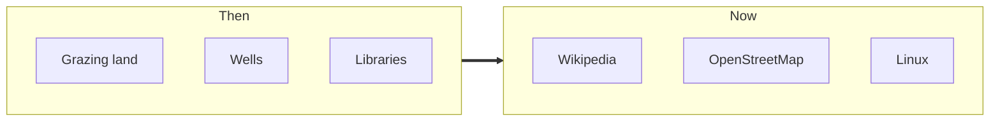
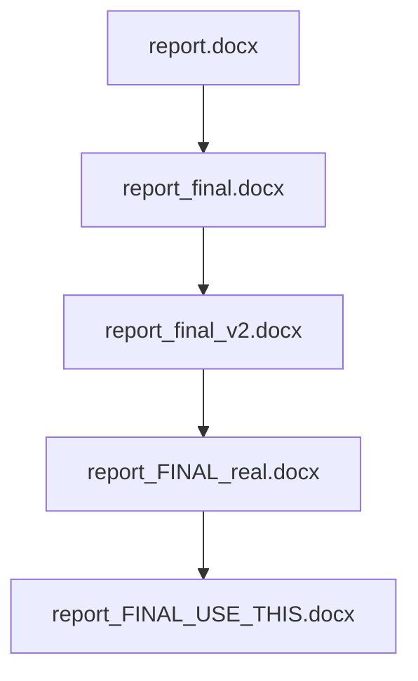
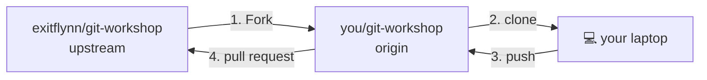
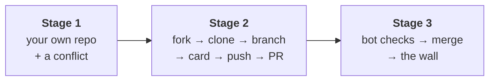

# Intro to FOSS & Git

Akshit Tyagi · [@exitflynn](https://github.com/exitflynn)

<!--
HOW TO EDIT: each slide is separated by `---`. Text in these comment blocks is speaker notes, shown only in presenter mode (/presenter).

⏱ 0:00. Don't start talking yet. Go straight to the next slide so installs start.
-->

---

# Before we start: install now

<div class="grid grid-cols-2 gap-8 items-center">
<div>

**github.com/exitflynn/git-workshop**

1. Make a **GitHub account**, verify your email
2. **Install Git** (see SETUP.md)
   - Windows: git-scm.com → installer
   - Mac: run `git --version` in Terminal → Install
3. Leave it running. We'll continue.

</div>
<div class="text-center">


</div>
</div>

<!--
⏱ 0:00–0:05

- Say: "Installs are slow. Start them now, we'll talk while they run."
- Windows installer: Next on everything except Editor (VS Code / Nano), branch name (main). It's in SETUP.md.
- Mac: Command Line Tools download is big. Start now.
- Keep this QR up ~1 min. Ask hands up: "Who has a GitHub account already?"
- Point: slides are live at exitflynn.github.io/git-workshop — they can follow along on laptops.
-->

---

# Today

| | |
|---|---|
| 0:05 | FOSS |
| 0:35 | Break · finish setup |
| 0:45 | Git |
| 1:25 | Lab: your first pull request |
| 2:20 | What next |

<!--
⏱ 0:05

- By the end: everyone has a real pull request merged into a public repo, and their name on a website.
- Don't linger. 20 seconds.
-->

---
layout: section
---

# Part 1: FOSS

---
layout: center
class: question
---

# What is FOSS?

<!--
⏱ 0:06

- Ask the room. Wait. Collect 3–4 answers.
- Likely answers: "free software", "open source", "Linux", "you can see the code".
- Say "all fair" and move on. Don't correct yet.
-->

---

# Free and Open Source Software

- **Open source:** you can read the code
- **Free:** freedom, not price

<v-click>

> "Free as in *free speech*, not as in *free beer*."

</v-click>

<!--
⏱ 0:09

- Most of you read "free" as ₹0. That's not the point.
- The free beer line: free beer = someone gives you something. Free speech = something you're allowed to do.
- Some FOSS costs money. Some ₹0 software (WhatsApp, Instagram) is not free at all.
-->

---

# The four freedoms

| | |
|---|---|
| **0** | **Use** it for any purpose |
| **1** | **Study** how it works, and change it |
| **2** | **Share** copies |
| **3** | **Share your changes** |

<div class="muted mt-8">Free Software Foundation definition. Numbered from 0, because programmers.</div>

<!--
⏱ 0:10

- Freedom 1 and 3 need the source code. That's where "open source" comes from.
- Quick: does Instagram give you any of these? (No. Not even 0 — you agree to their terms.)
-->

---

# You already use it

<div class="grid grid-cols-3 gap-4 mt-8 text-xl">
<div>VLC</div>
<div>Firefox</div>
<div>Android</div>
<div>Linux</div>
<div>VS Code (its core)</div>
<div>Blender</div>
<div>OBS</div>
<div>Python</div>
<div>Git</div>
</div>

<!--
⏱ 0:12

- Ask: "Who has VLC installed?" Hands go up. "That's FOSS."
- Android: the base (AOSP) is open source; Google adds closed parts on top.
- VS Code: open-source core ("Code - OSS"), Microsoft ships its own build with extras.
-->

---

# The commons

Things that belong to everyone.

<v-clicks>

- Village grazing land
- Wells, rivers
- Public libraries, parks

</v-clicks>

<!--
⏱ 0:13

- Before property was everything, communities shared resources. Nobody owned the well; everybody used it; everybody looked after it.
- Commons only work if people maintain them. Hold that thought — it comes back with maintainers.
-->

---

# Digital commons



<!--
⏱ 0:15

- Same idea, but copying is free. A well runs dry if everyone takes water. Wikipedia doesn't.
- Wikipedia isn't software, but it's the clearest example: written by volunteers, owned by nobody, used by everyone.
- FOSS = the software part of the digital commons.
-->

---

# The industry runs on FOSS

- **Linux** runs most servers, all top-500 supercomputers, every Android phone
- **Languages:** Python, JavaScript engines, Rust, Go
- **Infra:** Kubernetes, PostgreSQL, nginx
- **Tools:** Git, VS Code core

<v-click>

Live: **github.com/python/cpython**

</v-click>

<!--
⏱ 0:17

- Open github.com/python/cpython in the browser. Click into Objects/ → listobject.c. "This is the code that runs when you make a Python list."
- Point: it's not magic. It's code, written by people, and you can read it.
- Keep it to 2 min.
-->

---

# Who builds it?

- **Maintainers:** people who review, merge, fix, and keep a project alive
- Some are paid by companies
- Many do it **in their free time**

<!--
⏱ 0:19

- Anyone can contribute. Maintainers decide what gets in.
- Popular projects have teams. Most projects have 1–2 people.
-->

---

# Dependency


<div class="muted text-center">xkcd.com/2347 · CC BY-NC 2.5</div>

<!--
⏱ 0:20

- Let them read it. Wait for the laugh.
- "This is a joke. It's also true. Next slide."
-->

---

# xz-utils, 2024

<v-clicks>

- `xz`: a compression library inside almost every Linux system
- Maintained by **one volunteer**, burnt out
- A stranger helps for **~2 years**, earns trust, becomes co-maintainer
- Then hides a **backdoor** that would have opened SSH on millions of servers
- Caught by accident: an engineer noticed SSH logins were **0.5 s slower**

</v-clicks>

<!--
⏱ 0:21–0:25

- CVE-2024-3094, found March 2024 by Andres Freund (Microsoft engineer working on PostgreSQL).
- "Jia Tan" was the attacker's name. Patient social engineering: fake accounts pressured the original maintainer (Lasse Collin) to hand over control.
- Lesson 1: the commons needs maintainers, and they're under-supported.
- Lesson 2: it was caught *because* the code was open. Someone could look.
-->

---

# Ways to look at FOSS

| View | Says |
|---|---|
| **Ethical** | Users deserve control over the software they use (FSF, 1985) |
| **Practical** | Open development makes better software (OSI, 1998) |
| **Economic** | Shared infrastructure is cheaper than everyone building their own |
| **You** | Public work is a portfolio. Real code, real reviews. |

<!--
⏱ 0:25

- Ethical: Richard Stallman, GNU project (1983), Free Software Foundation (1985).
- Practical: "Open source" was coined in 1998 to sell the idea to businesses without the ethics talk.
- Economic: why Google, Microsoft, Meta pay engineers to work on Linux, Kubernetes, React.
- You: your GitHub profile is a CV. Recruiters look.
-->

---

# Closed platforms

YouTube · Instagram · X

- You don't own your account, your audience, or the algorithm
- Built for profit. **Their incentive, not yours.**
- Rules change overnight, and you can't fork them

<!--
⏱ 0:27–0:30

- Not saying "delete Instagram". Saying: know who it works for.
- "Fork" — you'll learn this word in an hour. With FOSS, if the maintainers go bad, anyone can take the code and continue. You can't fork Instagram.
-->

---

# Licenses: the rules for reuse

| | You can | You must |
|---|---|---|
| **MIT / Apache** | Do almost anything, even closed products | Keep the credit |
| **GPL** | Use, change, share | Share your changes under GPL too |
| **No license** | Look at it | Nothing else. All rights reserved. |

<div class="muted mt-6">Linux and Git: GPL. VS Code core, React: MIT. Choose one: choosealicense.com</div>

<!--
⏱ 0:31

- GPL = "copyleft": freedom has to be passed on.
- Big trap: public code on GitHub with no LICENSE file is NOT free to reuse.
- If you publish a project, add a license. 30 seconds on choosealicense.com.
-->

---
layout: center
class: question
---

# Who wrote Git?

<!--
⏱ 0:32

- Ask. Someone might say Linus. If not, wait 5s, then next slide.
-->

---

# Linus Torvalds, 2005

<v-clicks>

- Linux was managed with **BitKeeper**, a closed tool, free for Linux devs
- 2005: the free license was pulled
- Linus wrote his own: **Git**. Usable in about two weeks.
- Today: almost every software project uses it

</v-clicks>

<v-click>

**The tool we're about to learn exists because of FOSS.**

</v-click>

<!--
⏱ 0:33–0:35

- Same person who wrote Linux in 1991.
- A closed tool was taken away → the community built an open one → it beat everything.
- This is the bridge. Pause after the last line. Then: break.
-->

---
layout: center
---

# Break · 10 min

Finish setup

```bash
git --version
git config --global user.name "Your Name"
git config --global user.email "you@example.com"   # same as GitHub
git config --global init.defaultBranch main
git config --global core.editor "code --wait"      # or: nano
```

Done? Help your neighbour.

<!--
⏱ 0:35–0:45

- Walk the room. Look for: no Git Bash on Windows, Mac Command Line Tools still downloading.
- Keep the troubleshooting slide (next) ready.
- Anyone totally stuck → Codespaces (SETUP.md, bottom).
-->

---

# If something breaks

| You see | Fix |
|---|---|
| `git: command not found` | Close and reopen terminal. Windows: use **Git Bash** |
| `Author identity unknown` | `git config --global user.name / user.email` |
| `Password authentication is not supported` | Windows: Git Credential Manager. Mac/Linux: `gh auth login` |
| Screen full of `~`, can't exit | Vim. `Esc` then `:wq` then `Enter` |
| `not a git repository` | Wrong folder. `pwd`, then `cd` |
| Nothing works | Codespaces (SETUP.md) |

<div class="muted">Full list: TROUBLESHOOTING.md</div>

<!--
Flash this whenever someone shouts an error. Point at the row.
-->

---
layout: section
---

# Part 2: Git

---
layout: center
class: question
---

# Who has used Git?

<!--
⏱ 0:45

- Hands up: used Git? Used GitHub? Usually more hands for GitHub. Use that to set up next slide.
-->

---

# Git ≠ GitHub

<div class="grid grid-cols-2 gap-12 mt-6">
<div>

### Git
- A **tool** on your laptop
- Tracks history of a folder
- Works offline
- FOSS (GPL)

</div>
<div>

### GitHub
- A **website** that hosts Git repos
- Owned by Microsoft (2018)
- **Closed source**
- Alternatives: GitLab, **Codeberg** (non-profit)

</div>
</div>

<v-click>

<div class="mt-8 text-center text-xl">Git : GitHub :: email : Gmail</div>

</v-click>

<!--
⏱ 0:47

- Irony moment: we just spent 30 min on why closed platforms aren't great. GitHub is one. Honest answer: it's where the projects are, so we use it. Codeberg exists if you want to move.
-->

---

# Sound familiar?

<div class="grid grid-cols-2 gap-8 items-center">
<div>



</div>
<div>

<v-clicks>

- Which one is latest?
- What changed between v2 and FINAL_real?
- Your friend edited v2 too. Now what?

</v-clicks>

</div>
</div>

<!--
⏱ 0:48

- Everyone has done this. Get the laugh.
- These three questions are exactly what Git answers.
-->

---
layout: center
---

# How most people learn Git


<div class="credit">Rachel M. Carmena, "How to teach Git" · CC BY-NC 4.0</div>

<!--
⏱ 0:49

- "This is how most people learn Git. Three magic words on a sticky note. Works until something goes wrong."
- "Today we do it the other way: we invent Git ourselves. Then the commands make sense."
- Idea from Tom Preston-Werner's "The Git Parable" (2009). He co-founded GitHub.
-->

---
layout: section
---

# Let's invent Git

You have: a text editor, folders, copy and paste.

<!--
⏱ 0:50

- Setup: you're writing a program. No Git exists. Just folders.
- Ask the room at each step: "what would you do?" Let them invent it. Then show the slide.
-->

---

# 1 · Save points

Problem: you broke something. Yesterday's version is gone.

<v-click>

```text
my-project/
├── working/        ← you edit here
├── snapshot-0/     ← copy of working/, Monday
├── snapshot-1/     ← Tuesday
└── snapshot-2/     ← today
```

Rule: **never change a snapshot.**

</v-click>

<!--
⏱ 0:51

- Ask: "How do you make sure you can go back?" Someone will say "make a copy". Yes.
- Like a save point in a video game.
- Never edit a snapshot: then you can always trust it.
-->

---

# 2 · Notes on each snapshot

Problem: which snapshot added the goodbye line?

<v-click>

```text
snapshot-2/
├── greet.py
└── message         ← "Add goodbye. Akshit, 2 Nov."
```

</v-click>

<v-click>

<div class="mt-4">You invented a <mark>commit</mark>: snapshot + message.</div>

</v-click>

<!--
⏱ 0:52

- Folder names tell you nothing. So add a small text file to each snapshot: what changed, who, when.
-->

---

# 3 · Going back for a fix

Release 1.0 was `snapshot-99`. You're now at `snapshot-110`, half-done features.

A user reports a bug in 1.0.

<v-clicks>

- Copy `snapshot-99` into `working/`, fix the bug, save `snapshot-111`
- But 111 isn't built on 110. It's built on **99**.
- So write it down:

</v-clicks>

<v-click>

```text
snapshot-111/message
  parent: snapshot-99
  Fix crash in 1.0
```

History is now a **tree**, not a line.

</v-click>

<!--
⏱ 0:54

- Ask: "You can't ship the half-done features. What do you do?"
- Key idea: every snapshot remembers its parent. That's how Git knows history.
-->

---

# 4 · Names for the tips

Problem: which snapshot is the latest of each line of work?

<v-click>

```text
my-project/branches
  main:    snapshot-110
  hotfix:  snapshot-111
```

New snapshot on `main`? Update that one line.

</v-click>

<v-click>

You invented a <mark>branch</mark>: a name pointing at the latest snapshot.

</v-click>

<!--
⏱ 0:56

- A branch is not a copy of your files. It's a name. One line in a file.
- "Switching branch" = look up the name, copy that snapshot into working/.
- Later we'll open the real file in .git and see exactly this.
-->

---

# 5 · Linus joins

Linus works on his laptop, offline, for a week. He makes `snapshot-114`.

You also made `snapshot-114`. 💥

<v-clicks>

- Numbers clash. Name each snapshot by a **hash** of its contents instead: `0dad3f5`
- Add the **author** to the message
- Now snapshots can be copied between laptops safely

</v-clicks>

<v-click>

You invented <mark>commit IDs</mark> and a <mark>distributed</mark> system. Works offline.

</v-click>

<!--
⏱ 0:58

- Hash: a fingerprint computed from the content. Same content → same name. Different content → different name. No central counter needed.
- Distributed: every laptop has the full history. No server needed to commit. Network only to share.
-->

---

# 6 · Combining work

You built feature A. Linus built feature B. You want both.

<v-click>

```text
snapshot-5baf58a/message
  parent: b5a5780      ← yours
  parent: 60df96e      ← Linus's
  Merge Linus's work
```

A snapshot with **two parents**: a <mark>merge</mark>.

</v-click>

<!--
⏱ 0:59

- If you both changed different lines: combine automatically.
- Same line changed differently: a human decides. That's a conflict.
-->

---

# 7 · Choosing what to save

Problem: you fixed a bug **and** started a feature. You want two separate snapshots.

<v-click>

```text
my-project/
├── working/
├── staging/        ← copy in only what goes in the next snapshot
└── snapshot-…/
```

You invented the <mark>staging area</mark>.

</v-click>

<!--
⏱ 1:00

- Packing a box before you seal it. Put in only what belongs together.
- Snapshot is made from staging/, not from working/.
-->

---

# 8 · What changed?

Compare two folders line by line:

<v-click>

```diff
 print("Hello")
+print("Bye")
```

You invented <mark>diff</mark>.

</v-click>

<!--
⏱ 1:01
-->

---

# You just invented Git

| You built | Git calls it |
|---|---|
| `working/` | working directory |
| `staging/` | staging area |
| snapshot + message | **commit** |
| `parent:` line | parent commit |
| `branches` file | **branch** |
| hash name | commit ID |
| copying snapshots to Linus | **push / pull** |
| snapshot with two parents | **merge** |

<div class="muted">Based on "The Git Parable", Tom Preston-Werner (2009)</div>

<!--
⏱ 1:02

- Pause here. "Everything Git does is one of these ideas."
- Now we look at the real thing.
-->

---

# The four areas


<div class="credit">Rachel M. Carmena, "How to teach Git" · CC BY-NC 4.0</div>

<!--
⏱ 1:03

- Same as the parable. Working dir = working/. Staging = staging/. Local repository = all the snapshots (hidden .git folder).
- Remote repository = Linus's copy, or GitHub.
- Learn these four names. Every Git message uses them.
-->

---

# Moving between them


<div class="credit">Rachel M. Carmena, "How to teach Git" · CC BY-NC 4.0</div>

<!--
⏱ 1:04

- Now the post-it makes sense. add = into staging. commit = seal a snapshot. push = send to remote.
-->

---

# Terminal survival

| Command | Does |
|---|---|
| `pwd` | where am I? |
| `ls` | what's here? |
| `cd folder` | go into folder |
| `cd ..` | go up |
| `mkdir name` | make a folder |
| `Tab` | autocomplete |
| `↑` | previous command |

<!--
⏱ 1:05

- 1st years: many have never used a terminal. That's fine.
- Tab completion saves you from typos.
- Windows: these work in Git Bash, not CMD.
-->

---
layout: center
class: question
---

# Guess the output

<!--
⏱ 1:06

- Format: I show a command, you guess, I reveal.
- We're writing greet.py, a tiny program.
-->

---

# `git init`

```bash
mkdir my-project
cd my-project
git init
```

<v-click>

```text
Initialized empty Git repository in .../my-project/.git/
```

Creates `.git/`: where the snapshots, messages and branches file live.

</v-click>

<!--
- Ask: "What do you think this does?"
- Delete .git = delete history. Your files stay.
-->

---

# `git status`

```bash
git status
```

<v-click>

```text {1,3,5}
On branch main

No commits yet

nothing to commit (create/copy files and use "git add" to track)
```

**Run it all the time.** It tells you what to do next.

</v-click>

<!--
- Read the last line out loud. Git literally tells you the next command.
-->

---

# Make a file

```bash
echo 'print("Hello")' > greet.py
git status
```

<v-click>

```text {5-7}
On branch main

No commits yet

Untracked files:
  (use "git add <file>..." to include in what will be committed)
	greet.py
```

Untracked: Git sees it, has never saved it.

</v-click>

---

# Tracked and untracked


<div class="credit">Rachel M. Carmena, "How to teach Git" · CC BY-NC 4.0</div>

<!--
- Tracked: Git has a snapshot of it. Untracked: new, Git has never saved it.
- git add makes it tracked.
-->

---

# `git add`

```bash
git add greet.py
git status
```

<v-click>

```text {5-7}
On branch main

No commits yet

Changes to be committed:
  (use "git rm --cached <file>..." to unstage)
	new file:   greet.py
```

In `staging/`. Not saved yet.

</v-click>

---

# `git commit`

```bash
git commit -m "Add greeting"
```

<v-click>

```text
[main (root-commit) 0dad3f5] Add greeting
 1 file changed, 1 insertion(+)
 create mode 100644 greet.py
```

Snapshot saved. `0dad3f5` = its hash name. `root-commit` = no parent.

</v-click>

<!--
- -m = message. Without -m, Git opens your editor (that's why we set core.editor).
-->

---

# Change it

```bash
echo 'print("Bye")' >> greet.py
git status
```

<v-click>

```text {2,5}
On branch main
Changes not staged for commit:
  (use "git add <file>..." to update what will be committed)
  (use "git restore <file>..." to discard changes in working directory)
	modified:   greet.py
```

</v-click>

---

# `git diff`

```bash
git diff
```

<v-click>

```diff
diff --git a/greet.py b/greet.py
index 2f9a147..d65f4e3 100644
--- a/greet.py
+++ b/greet.py
@@ -1 +1,2 @@
 print("Hello")
+print("Bye")
```

</v-click>

---

# Three states, three diffs


<div class="credit">Rachel M. Carmena, "How to teach Git" · CC BY-NC 4.0</div>

<!--
- modified = changed in working dir. staged = in staging. committed = in a snapshot.
- git diff = working vs staging. git diff --staged = staging vs last commit. git diff HEAD = working vs last commit.
- Don't memorise. Just know diff has variants.
-->

---

# `git log`

```bash
git add greet.py
git commit -m "Add goodbye"
git log
```

<v-click>

```text
commit ff836f30436d874e92caa1f9a2baa81b389c52b4
Author: Akshit Tyagi <akshit@example.com>
Date:   Mon Nov 2 10:00:00 2026 +0530

    Add goodbye

commit 0dad3f5a5c78276b91eb688a8a69259fb82ee8d7
Author: Akshit Tyagi <akshit@example.com>
Date:   Mon Nov 2 10:00:00 2026 +0530

    Add greeting
```

</v-click>

<!--
- Hash, author, date, message. Exactly the parable's message file.
- `git log --oneline` for the short version.
-->

---

# Look inside a commit

```bash
git cat-file -p HEAD
```

<v-click>

```text {2,6}
tree 605bfbef99af283211d92ed9c0f110be56fba36a
parent 0dad3f5a5c78276b91eb688a8a69259fb82ee8d7
author Akshit Tyagi <akshit@example.com> 1793593800 +0530
committer Akshit Tyagi <akshit@example.com> 1793593800 +0530

Add goodbye
```

The parable's `message` file. With a `parent:` line.

</v-click>

<!--
- HEAD = "the commit I'm on right now".
- tree = the snapshot of the files.
- You don't need this command day to day. It's here to prove the parable is real.
-->

---

# The branches file is real

```bash
cat .git/refs/heads/main
```

<v-click>

```text
ff836f30436d874e92caa1f9a2baa81b389c52b4
```

A branch is a file containing one hash. That's it.

</v-click>

<!--
⏱ 1:13

- This usually gets a reaction. A branch is 41 bytes.
-->

---

# New branch

```bash
git switch -c loud            # -c = create
git branch
```

<v-click>

```text
* loud
  main
```

</v-click>

<v-click>

```bash
cat .git/refs/heads/loud
```

```text
ff836f30436d874e92caa1f9a2baa81b389c52b4
```

Same hash as `main`. A new name for the same snapshot.

</v-click>

<!--
⏱ 1:14

- Creating a branch copies nothing. It writes one file.
- * = the branch you're on.
-->

---

# Two lines of work

On `loud`:

```bash
# edit line 1 → print("HELLO!")
git commit -am "Shout the greeting"
```

Back on `main`:

```bash
git switch main
# edit line 1 → print("Hello, world")
git commit -am "Greet the world"
```

<v-click>

Same line, changed differently on two branches. What happens on merge?

</v-click>

<!--
- -am = stage all tracked changes + commit. Shortcut.
- Ask the room before clicking.
-->

---

# `git merge`

```bash
git merge loud
```

<v-click>

```text {2}
Auto-merging greet.py
CONFLICT (content): Merge conflict in greet.py
Automatic merge failed; fix conflicts and then commit the result.
```

**Not an error.** Git is asking you to decide.

</v-click>

<!--
⏱ 1:16

- Different lines changed → Git merges by itself. Same line → you decide.
-->

---

# Anatomy of a conflict

```text
<<<<<<< HEAD
print("Hello, world")
=======
print("HELLO!")
>>>>>>> loud
print("Bye")
```

| | |
|---|---|
| `<<<<<<< HEAD` | your branch (main) |
| `=======` | divider |
| `>>>>>>> loud` | the other branch |

<v-click>

Keep what you want, **delete the 3 marker lines**, then `git add` + `git commit`.

</v-click>

<!--
- VS Code shows buttons: "Accept Current / Incoming / Both". Same thing.
-->

---

# Two parents

```bash
git add greet.py
git commit -m "Merge loud"
git cat-file -p HEAD
```

<v-click>

```text {2-3}
tree e4ced5faa4b65249e854abc58faac6c5ee6fef50
parent b5a5780d3744c10e27b4bcefa298c2444b3fc47f
parent 60df96eb2d00aaf8471b69bf0161aaf65521388c
author Akshit Tyagi <akshit@example.com> 1793593800 +0530
committer Akshit Tyagi <akshit@example.com> 1793593800 +0530

Merge loud
```

Parable step 6, for real.

</v-click>

<!--
⏱ 1:17
-->

---

# `git clone`


<div class="credit">Rachel M. Carmena, "How to teach Git" · CC BY-NC 4.0</div>

<!--
⏱ 1:18

- Download all the snapshots (local repo) + the latest files (working dir).
- origin = default name for the remote you cloned from.
-->

---

# `git push`


<div class="credit">Rachel M. Carmena, "How to teach Git" · CC BY-NC 4.0</div>

<!--
- Send your new snapshots to the remote. Parable: copying snapshots to Linus.
- First push on Windows: browser opens to sign in.
-->

---

# `git fetch`


<div class="credit">Rachel M. Carmena, "How to teach Git" · CC BY-NC 4.0</div>

<!--
- Get Linus's new snapshots into my local repo. My files don't change.
-->

---

# `git pull`


<div class="credit">Rachel M. Carmena, "How to teach Git" · CC BY-NC 4.0</div>

<!--
- pull = fetch + merge. Get them, then merge into my working directory.
- Most days you just use pull.
-->

---

# Fork and pull request



- **Fork:** your own copy on GitHub (you can't push to mine)
- **Pull request:** "please pull my changes into yours"

<!--
⏱ 1:19

- Fork and PR are GitHub features, not Git commands.
- This is how you contribute to almost any open-source project.
- Maintainers review the PR, comment, ask for changes, then merge.
-->


---

# All you need today

| | |
|---|---|
| `git status` | what's going on? |
| `git add <file>` | stage |
| `git commit -m "..."` | save snapshot |
| `git log --oneline` | history |
| `git diff` | what changed |
| `git switch -c <name>` | new branch |
| `git merge <branch>` | combine |
| `git clone <url>` | download repo |
| `git push` / `git pull` | sync with remote |

<div class="muted">Git has 150+ commands. These cover most days.</div>

<!--
⏱ 1:20
-->

---
layout: center
---

# Live

`init` → `add` → `commit` → `log`

<!--
⏱ 1:20–1:24 (max 4 min)

Switch to your terminal. Bump the font size first (Cmd +).

  cd ~ && rm -rf live-demo && mkdir live-demo && cd live-demo
  git init
  echo 'print("Hello")' > greet.py
  git status
  git add greet.py
  git commit -m "Add greeting"
  git log
  cat .git/refs/heads/main

- Point: "that's all real, nothing special about the slides."
- If something weird happens: good, read the message out loud, that's the skill.
-->

---
layout: section
---

# Part 3: Lab

---

# The plan



<div class="mt-6">

Steps: **github.com/exitflynn/git-workshop** → `practice/` then `CONTRIBUTING.md`

Stuck → neighbour → TROUBLESHOOTING.md → Codespaces

</div>

<!--
⏱ 1:25

- Stage 1 ~20 min, Stage 2 ~25 min, Stage 3 ~10 min.
- Rule: if you're done, help the person next to you.
- Don't wait more than a minute for stragglers. They have the written steps.
-->

---

# Stage 1 · Make a repo

<div class="grid grid-cols-[3fr_2fr] gap-6 items-start">
<div>

```bash
cd ~
mkdir git-practice
cd git-practice
git init
echo 'print("Hello")' > greet.py
git status
git add greet.py
git commit -m "Add greeting"
echo 'print("Bye")' >> greet.py
git diff
git add greet.py
git commit -m "Add goodbye"
git log
```

</div>
<div>


<div class="muted">Recap: <b>add</b> → staging, <b>commit</b> → local repository. No push yet.</div>

</div>
</div>

<div class="credit">Diagram: Rachel M. Carmena · CC BY-NC 4.0</div>

<!--
- `cd ~` first. Never `git init` in your home folder itself.
- Run `git status` after every step if unsure.
- Check: everyone sees two commits in log? Thumbs up.
-->

---

# Stage 1 · Branch and conflict

<div class="recap">Recap: a branch is a name for a snapshot. Same line changed on two branches → you decide.</div>

```bash
git switch -c loud
code greet.py              # line 1 → print("HELLO!"), save
git commit -am "Shout the greeting"

git switch main
code greet.py              # line 1 → print("Hello, world"), save
git commit -am "Greet the world"

git merge loud             # CONFLICT. Expected.
```

Fix `greet.py` (delete `<<<<<<<` `=======` `>>>>>>>`), then:

```bash
git add greet.py
git commit -m "Merge loud"
git cat-file -p HEAD       # two parents
```

<!--
⏱ ~1:40 should be done with stage 1.
- `code` not found on Windows? Open the file from VS Code manually, or `nano greet.py`.
- Commit opened an editor and "nothing happens"? Save and close the tab.
- Fast finishers: cat .git/refs/heads/main and .git/refs/heads/loud.
-->

---

# Stage 2 · Fork and clone

<div class="grid grid-cols-[3fr_2fr] gap-6 items-start">
<div>

1. **github.com/exitflynn/git-workshop** → **Fork**
2. Then:

```bash
cd ~
git clone https://github.com/<you>/git-workshop.git
cd git-workshop
git switch -c add-<you>
```

<div class="muted">Replace &lt;you&gt; with your GitHub username. Clone <b>your fork</b>, not mine.</div>

</div>
<div>


</div>
</div>

<div class="credit">Diagram: Rachel M. Carmena · CC BY-NC 4.0</div>

<!--
⏱ 1:45
- Most common mistake: cloning exitflynn/git-workshop. Push will fail with "Permission denied". Fix in TROUBLESHOOTING.
-->

---

# Stage 2 · Your Top 4

```bash
cp participants/exitflynn.md participants/<you>.md
code participants/<you>.md
```

```md
---
name: Your Name
top4:
  - Movie One
  - Movie Two
  - Movie Three
  - Movie Four
---
Optional one-liner.
```

File name = **your exact GitHub username**. Only your file.

<!--
- Letterboxd joke lands here.
- Bot checks: name present, exactly 4 movies, file name matches username.
-->

---

# Stage 2 · Push and open the PR

<div class="recap">Recap: add → commit → <b>push</b> to your fork → <b>pull request</b> to mine</div>

```bash
git status
git add participants/<you>.md
git commit -m "Add <you>'s top 4"
git push -u origin add-<you>
```

Then on GitHub: **Compare & pull request** → **Create pull request**

<div class="muted">Windows: first push opens a browser to sign in. Mac/Linux: run <code>gh auth login</code> first.</div>

<!--
⏱ ~2:05 most should have a PR open.
- Bot ❌? Read its comment, fix, add, commit, push. Same PR updates automatically.
-->

---

# Stage 3 · Merge

<div class="recap">A maintainer reviews → merges → your commit is in upstream main</div>

- First few: merged **live** here
- Then the bot merges valid cards automatically

**exitflynn.github.io/git-workshop/wall/**

<!--
⏱ 2:05–2:15

- On projector: open a PR, show "Files changed", show the bot comment, click Squash and merge. Do 2–3.
- Then: repo Settings → Secrets and variables → Actions → Variables → AUTO_MERGE = true.
- Put the wall on the projector. It refreshes every 20s. Read out the "Most picked" strip.
- Pages deploy takes ~1 min per merge, batched.
-->

---

# Bonus: get everyone's cards

```bash
git remote add upstream https://github.com/exitflynn/git-workshop.git
git pull upstream main
ls participants
```

<!--
- Now their local copy has everyone's files. This is how you keep a fork up to date.
-->

---
layout: section
---

# What next

---

# Your first real contribution

- Find projects: **goodfirstissue.dev**, **up-for-grabs.net**
- Look for labels: `good first issue`, `help wanted`
- Read **README** and **CONTRIBUTING.md** first
- Start small: docs, typos, tests
- Typo in these slides? **Send a PR.**

<!--
⏱ 2:20

- CONTRIBUTING.md in this repo is a real example of the file every project has.
- Programs: Google Summer of Code (paid, for students), Hacktoberfest (October).
- Fixing docs is real contribution. Maintainers love it.
-->

---

# VS Code does this too

The **Source Control** panel runs the same commands.

| Button | Command |
|---|---|
| `+` on a file | `git add` |
| ✓ Commit | `git commit` |
| Sync | `git pull` + `git push` |

Now you know what the buttons do.

<!--
⏱ 2:25
-->

---
layout: center
---

# Thanks

**Slides:** exitflynn.github.io/git-workshop

**Repo:** github.com/exitflynn/git-workshop

Akshit Tyagi · [@exitflynn](https://github.com/exitflynn)

<div class="muted mt-8">
Credits: "The Git Parable", Tom Preston-Werner · Git diagrams: Rachel M. Carmena, "How to teach Git" (CC BY-NC 4.0) · xkcd 2347 (CC BY-NC 2.5)
</div>

<!--
⏱ 2:27 · Q&A.
-->

---
layout: section
---

# Appendix

---

# SSH (optional)

```bash
ssh-keygen -t ed25519 -C "you@example.com"    # Enter for defaults
cat ~/.ssh/id_ed25519.pub                       # copy this
```

GitHub → Settings → SSH and GPG keys → **New SSH key** → paste

```bash
ssh -T git@github.com
```

Port 22 blocked? Use SSH over port 443 (GitHub docs).

<!--
Only show if asked. HTTPS is enough for today.
-->
